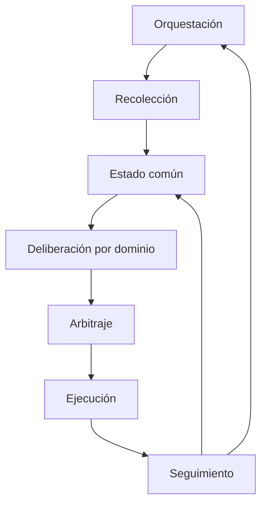

# Arquitectura de módulos operativos

La organización principal del plugin es ORQUESTRADOR con SPY, DIPLOMAT, GENERAL, INVESTIGATOR, SHIPPER, WORLDLORD y MAYOR como áreas independientes. Leer [módulos por área](dominios.md) para sus límites y [UPGRADERS](upgraders.md) para los Debugger y Learner propios de cada uno. La tabla siguiente describe los servicios internos que comparten esas áreas.

La capa principal usa los nombres definidos por el usuario: ORQUESTRADOR, SPY, DIPLOMAT, GENERAL, INVESTIGATOR, SHIPPER, WORLDLORD y MAYOR. Leer [módulos por área](dominios.md) para su propiedad, invocación y coordinación. Cada módulo incorpora sus propios [Debugger y Learner](upgraders.md). Las etapas descritas a continuación son servicios internos comunes.

Versión del contrato: 1.0.0. Familia incorporada el 24/11/2026. El registro ejecutable de capacidades está en modulos.json.

## Flujo y responsabilidades

El orquestador coordina el ciclo. Los recolectores aportan observaciones; el normalizador conserva hechos y antigüedad; los asesores calculan alternativas; el árbitro selecciona un conjunto viable; el ejecutor despacha por una capacidad real; el seguimiento compara resultados y actualiza hechos. Esas responsabilidades pueden crecer de forma independiente.

| Módulo | Entrada | Salida | Efectos admitidos |
| --- | --- | --- | --- |
| operativo-orquestador | Petición, configuración y último ciclo | cycle | Diario y configuración |
| operativo-recoleccion | Fuentes identificadas | observation_batch | Lectura |
| operativo-estado | observation_batch, revisiones y reservas | snapshot | Observaciones consolidadas |
| operativo-deliberacion | snapshot y objetivo | proposal por dominio | Cálculos y alternativas |
| operativo-arbitraje | snapshot y propuestas | decision | Selección; compromisos al aceptar ejecución |
| operativo-ejecucion | decision, estado y alcance autorizado | receipt | Despacho manual actual |
| operativo-seguimiento | receipt y nueva evidencia | cycle, nuevos lotes | Conciliación y liberación de compromisos |

Las dependencias del registro describen el orden de una iteración y forman un grafo sin ciclos. La realimentación de seguimiento abre la siguiente iteración; no es una dependencia circular de carga.

## Plano común de datos

Usar sobres con schema_version, kind, id, account_id, world, created_at, producer y data. Separar las siguientes identidades:

- Cuenta: identidad estable de la ficha autenticada, no solo alias.
- Mundo: código canónico, por ejemplo s74-es, tomado del registro.
- Entidad: account, city:<id> o entidad externa identificada.
- Observación: campo, valor, unidad, fecha, calidad y fuente.
- Acción: ID estable, clave de idempotencia y snapshot de origen.
- Ciclo: una ejecución lógica con salidas por etapa y errores parciales.

Las lecturas conservan origen por campo. El inventario es observado; una proyección se guarda como cálculo; un envío se conserva como tránsito. La calidad uncertain impide comprometer su presupuesto. Campos no presentes no equivalen a cero.

Cada snapshot incluye las revisiones de las entidades que lo sustentan. Una actualización material invalida decisiones dependientes. No mezclar cortes de varias cuentas para suplir datos ausentes.

## Presupuestos y reservas

Expresar el consumo de cada acción en claims, con claves compartidas por todos los dominios:

| Clave orientativa | Unidad |
| --- | --- |
| city:<id>:wood, wine, marble, crystal, sulfur | Unidades de material |
| account:gold | Oro |
| account:merchant-ships | Barcos disponibles |
| account:freighters | Cargueros disponibles |
| city:<id>:citizens | Ciudadanos reasignables |
| city:<id>:construction-slot | Huecos de construcción utilizables |

Cada budget conserva observed_quantity, reserved_quantity, floor_quantity, observed_at y source_ref. Disponible = observado − reservado − mínimo. Los mínimos son parámetros del plan, no una mecánica inventada del juego.

No crear un presupuesto para un saldo desconocido. Los recursos futuros permanecen condicionados. Una acción presupuestada exige costes conocidos. Consumir de forma conservadora el mismo presupuesto durante todo el ciclo; la reutilización de una cola o barco requiere un corte nuevo. La extensión futura de reservas por intervalos deberá considerar salida, carga, llegada y retorno.

Una propuesta no consume presupuesto. Al autorizar su ejecución se reservan sus claims en el estado central con comparación de revisión. No hay transacción multi-registro en las herramientas actuales: el coordinador es único para ese registro y vuelve a leerlo antes de emitir instrucciones.

## Adaptadores

| Adaptador | Estado actual | Función |
| --- | --- | --- |
| account-records | available | Leer fichas, ciudades, planes e historial |
| supplied-evidence | available | Interpretar archivos y capturas accesibles |
| atlas-map | available | Leer la copia fechada del mapa disponible |
| shared-drive | planned | Leer archivos del grupo cuando exista acceso comprobado |
| manual-game | available | Entregar instrucciones y recoger confirmaciones |
| authorized-game | planned | Interfaz para un futuro conector de lectura o acción |

Un adaptador declara discover_capabilities, collect o preflight/dispatch/reconcile, errores recuperables, versión de contrato y efectos. Cada operación devuelve cuenta, mundo, fecha, correlación y resultado. Nunca transportar credenciales en el sobre ni en save_entry.

El comprobador local valida contratos y presupuestos; la etapa de estado verifica que las cifras y sus fuentes pertenecen a la cuenta correcta. Un JSON formalmente válido no demuestra la veracidad de sus datos. Una dependencia ordenada hace viable el plan, pero solo queda lista para despacho después de confirmar sus precondiciones.

Para dispatch usar action_id y la clave de idempotencia. Antes de reintentar una solicitud con resultado desconocido, consultar reconcile. El adaptador debe demostrar cómo deduplica o abstenerse de repetir. El lector no puede escribir acciones por disponer de una sesión.

## Estados y eventos

El ciclo puede estar collected, normalized, deliberated, arbitrated, awaiting_execution, reconciled, partial, blocked o failed. No es una máquina que avanza por temporizador: cada transición requiere una salida válida de la etapa o evidencia.

Los eventos lógicos son observation.received, snapshot.ready, proposal.ready, decision.selected, action.issued, action.confirmed, action.failed y cycle.reconciled. Por ahora se representan en el diario y las salidas del ciclo; no existe un bus de eventos residente ni un trabajador autónomo.

Errores por módulo: source_unavailable, incomplete_data, stale_data, world_mismatch, revision_conflict, budget_conflict, dependency_blocked, unsupported_capability y outcome_unknown. Conservar los resultados independientes y pausar solo lo que dependa del error.

## Objetivos y extensión

Usar un horizonte inicial de 12 horas, revisión orientativa a las 6 horas y objetivos configurables. El crecimiento rápido es el objetivo inicial de proyecto; los mínimos operativos y los acuerdos confirmados siguen siendo restricciones. Cambiar el objetivo no modifica datos ni supone una orden de atacar.

Para añadir un módulo:

1. Elegir responsabilidad e ID estable.
2. Añadir su carpeta con SKILL.md y descriptor en modulos.json.
3. Declarar versiones, dependencias, entradas, salidas, herramientas y efectos.
4. Reutilizar el estado común; evitar un inventario privado por asesor.
5. Añadir ejemplos y pruebas del contrato y del fallo parcial.
6. Habilitar únicamente las capacidades implementadas y verificadas.

Los contratos 1.x permiten extensiones opcionales documentadas. Los consumidores estrictos deben actualizar el esquema menor antes de recibir nuevos campos. Cambios semánticos de unidades, identidad o estados requieren una versión mayor y migración explícita.

El núcleo local valida contratos, grafo de módulos, coherencia temporal, orden de dependencias y presupuesto agregado. No optimiza una economía completa ni aplica acciones en el juego. La deliberación se realiza al invocar los módulos en ChatGPT; no se han creado tareas programadas.

## Aprendizaje transversal

Cada módulo conserva un perfil de investigación, evidencias, caducidades y métricas en `learning-engine`. ORQUESTRADOR comparte una cola acotada y la invalidación por dependencias. El núcleo local valida afirmaciones; `save_entry` conserva los registros con control de revisión. Los casos antiguos de preguntas siguen compatibles. El ciclo se activa al trabajar con nuevos datos; no hay un proceso residente ni un programador implícito.
